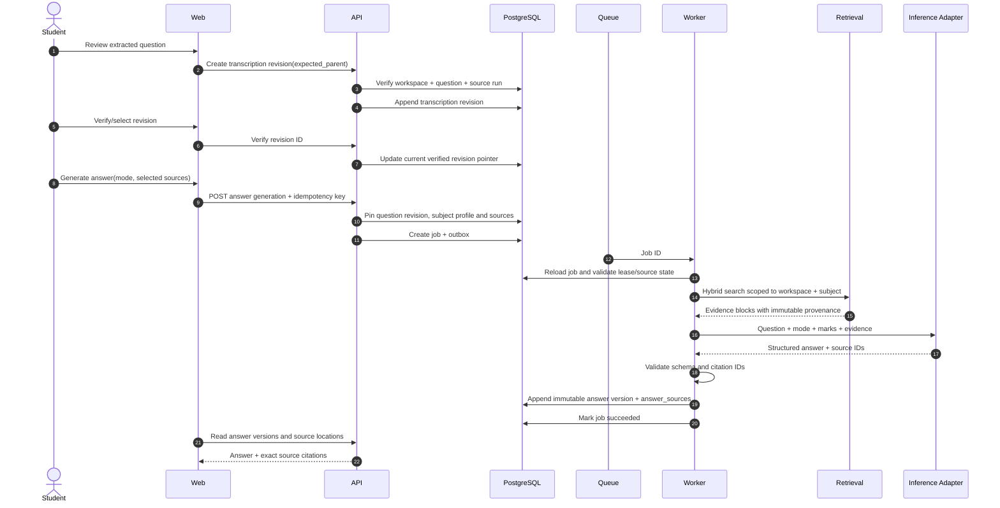

# Architecture flow diagrams

These diagrams describe the proposed system behavior. They are design artifacts, not implemented workflows.

## 1. Upload, validation and extraction

```mermaid
sequenceDiagram
    autonumber
    actor Student
    participant Web
    participant API
    participant DB as PostgreSQL
    participant Store as Private Object Storage
    participant Queue
    participant Worker

    Student->>Web: Select file and subject/category
    Web->>API: Create upload intent
    API->>DB: Verify workspace membership, subject and quota
    API->>DB: Create pending document + opaque object key
    API-->>Web: Short-lived signed PUT URL
    Web->>Store: Upload original bytes
    Web->>API: Finalize(document_id, idempotency_key)
    API->>Store: HEAD object and verify size/checksum
    API->>Worker: Validate signature in isolated job
    Worker->>Store: Read uploaded bytes
    Worker->>Worker: Type detection, limits, malware/parser isolation
    Worker-->>API: Validation result
    API->>DB: Persist immutable original metadata + processing job/outbox
    DB-->>Queue: Outbox dispatch
    Queue->>Worker: Job ID (at-least-once)
    Worker->>DB: Reload job/document and verify workspace + state
    Worker->>Store: Read immutable original
    Worker->>Worker: Parse native structure; OCR only where required
    Worker->>Store: Persist derived previews/artifacts
    Worker->>DB: Persist immutable processing run, pages and blocks
    Worker->>DB: Mark job succeeded
    Web->>API: Poll job/document status
    API-->>Web: Safe progress + extraction review data
```

Important: the API must not treat browser-reported MIME, size or checksum as proof of safety. The worker must verify file signature and limits before parsing. The queue payload contains a job ID, not document text or storage credentials.

## 2. Question verification and answer generation



The answer version snapshots the exact question transcription revision, subject-profile version, selected index/source versions and prompt-template version. Model output cannot select arbitrary tools or access other tenants.

## 3. Deletion and stale-worker protection

```mermaid
sequenceDiagram
    autonumber
    actor Student
    participant API
    participant DB as PostgreSQL
    participant Queue
    participant Worker
    participant Store as Object Storage

    Student->>API: Request document deletion
    API->>DB: Authorize and set deletion tombstone
    API->>DB: Block new jobs/retrieval and request cancellation
    DB-->>Queue: Existing jobs become cancellation candidates
    Queue->>Worker: Previously queued job may still arrive
    Worker->>DB: Reload job and document state
    DB-->>Worker: Tombstoned; do not process
    API->>DB: Create idempotent purge job
    Queue->>Worker: Purge job
    Worker->>DB: Verify purge ownership and lease
    Worker->>Store: Delete original and derived objects
    Worker->>DB: Delete/purge chunks, embeddings and derived records per policy
    Worker->>DB: Mark purge complete; retain minimal tombstone/audit
    API-->>Student: Deletion status
```

A worker must re-check tombstone and source revision immediately before committing derived output. A stale worker cannot resurrect content after deletion begins. Citation references resolve to an explicit source-deleted state rather than silently pointing to a different run.

## 4. Cross-cutting invariants

- All durable records and storage objects are workspace-scoped.
- Original bytes, raw extraction, verified transcriptions, answer versions and export snapshots are distinct artifacts.
- Queue delivery is at-least-once; all workers are idempotent.
- Every asynchronous write validates the current job lease and resource lifecycle state.
- Every answer/export pins exact immutable source and version IDs.
- Tenant scope is derived from verified identity and server-side membership, not from a client-controlled field.
